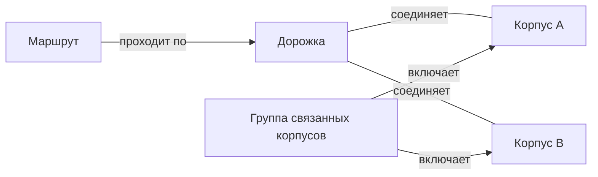
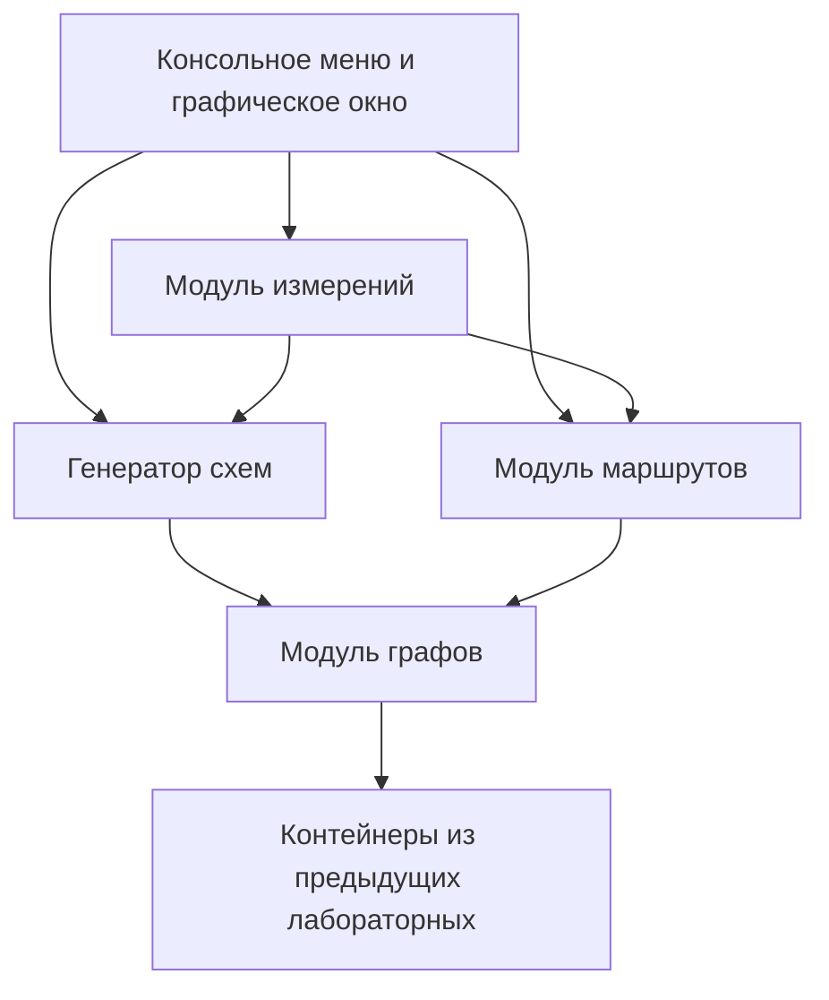

# Лабораторная работа № 3 · Маршруты по кампусу

В этой работе я строю схему пешеходных дорожек между корпусами и ищу
кратчайший маршрут. Для одной схемы сравниваю алгоритмы Дейкстры и
Беллмана–Форда. Ещё можно посмотреть, какие корпуса связаны между собой,
и сгенерировать схемы разных размеров для проверки алгоритмов.

**C++17** · **Python 3** · **Tkinter** · **Свои структуры данных**

[Дизайн](#дизайн) · [Запуск](#запуск) · [Проверки](#проверки) · [Измерения](#измерения)

## Дизайн

### 1. Постановка задачи

#### 1.1. Что делается в работе

Пользователь задаёт корпуса и пешеходные дорожки между ними, затем
выбирает, откуда и куда нужно пройти. Дорожка доступна в обе стороны
и имеет неотрицательную длину. Программа показывает последовательность
корпусов с минимальной суммарной длиной либо сообщает, что прохода нет.

Отдельно можно получить группы корпусов, внутри которых между любой
парой есть проход. Так видно, какие корпуса оказались изолированы, когда
из схемы убрали закрытую дорожку.

#### 1.2. Зачем это нужно

Та же задача возникает в пешеходных сетях, на территории предприятия
и при навигации между зданиями. Общее в этих задачах — двусторонние
участки с известной длиной и необходимость проверить, куда можно дойти
и какой путь будет короче.

### 2. Сущности прикладной задачи

#### 2.1. Описание сущностей

- **Корпус** — место, от которого можно начать или закончить маршрут.
  У корпуса есть номер на схеме и название.
- **Дорожка** — двусторонний проход между двумя разными корпусами.
  Длина дорожки известна заранее. У пары корпусов может быть одна прямая дорожка.
- **Маршрут** — последовательность корпусов от начала до назначения. Каждая
  соседняя пара соединена дорожкой. Длина маршрута равна сумме длин дорожек.
- **Группа связанных корпусов** — набор корпусов, между которыми есть
  проход и к которому нельзя присоединить ни одного другого корпуса. Изолированный корпус образует отдельную группу.

#### 2.2. Связи между сущностями



### 3. Архитектура

#### 3.1. Компоненты

1. **Пользовательский интерфейс** принимает схему и параметры генерации,
   запускает выбранную операцию и показывает её результат. Консольное
   меню подходит для текстовой работы, а графическое окно показывает
   дорожки, выделяет найденный маршрут и отмечает группы корпусов.
2. **Модуль маршрутов** находит кратчайшие пути и группы связанных корпусов.
   Поиск, генерация и измерения доступны через общее ядро.
3. **Модуль графов** хранит данные вершин и веса связей. Названия корпусов
   и единицы измерения относятся к прикладной части. Граф допускает
   другие данные вершин и целые или вещественные веса.
4. **Генератор схем** строит цепочку, кольцо или несколько отдельных
   цепочек заданного размера. Начальное число генератора задаёт веса
   дорожек воспроизводимо.
5. **Модуль измерений** сравнивает поиск на одной схеме из одного
   исходного корпуса и сохраняет результаты в открытом формате CSV.

#### 3.2. Связи между компонентами



#### 3.3. Ключевые решения и алгоритмы

- **Хранение связей.** Данные корпусов лежат в отдельной последовательности.
  Симметричная матрица смежности принадлежит графу. У каждой ячейки есть
  признак наличия дорожки и её длина, поэтому вес 0 допустим.
  Проверка одной пары требует `O(1)` времени, матрица занимает `O(V²)` памяти.
- **Алгоритм Дейкстры.** На каждом шаге выбираю непосещённую вершину с
  наименьшим известным расстоянием и проверяю дорожки из неё.
  При неотрицательных длинах после выбора её расстояние окончательное.
  Линейный выбор и просмотр строк матрицы дают `O(V²)` времени.
- **Алгоритм Беллмана–Форда.** Сначала получаю список дорожек из матрицы.
  Затем проверяю каждую дорожку в обоих направлениях и уточняю расстояния.
  Кратчайший путь можно выбрать простым, поэтому достаточно `V − 1`
  проходов. Если расстояния не изменились, поиск завершается раньше.
  С учётом чтения матрицы верхняя оценка времени — `O(V² + VE)`.
- **Восстановление пути.** При уменьшении расстояния запоминаю, из какого
  корпуса пришли. По этим данным восстанавливаю маршрут от конца к
  началу. При одинаковой длине программа может выдать любой кратчайший путь.
- **Связность.** Запускаю обход в ширину из каждого ещё не посещённого
  корпуса. Один запуск находит всю его группу. С матрицей общее время
  составляет `O(V²)`.
- **Сравнение.** Передаю обоим алгоритмам одну схему и один исходный корпус.
  Оба находят расстояния до всех достижимых корпусов. Построение исходного
  графа и вывод результатов выполняются вне замера. Подготовка списка
  дорожек входит во время Беллмана–Форда.

### 4. Функциональные требования

- **К схеме кампуса**
  - Принимать названия корпусов, пары их номеров и длины дорожек.
  - Позволять просматривать схему и редактировать дорожки.
  - Отклонять петли, повторное задание одной дорожки, неизвестные номера,
    отрицательные и неконечные длины.
- **К поиску маршрута и связности**
  - Позволять запускать каждый из двух алгоритмов поиска и обход в ширину
    на произвольной схеме в пределах поддерживаемого размера.
  - Показывать порядок корпусов и общую длину найденного маршрута.
  - Сообщать, когда назначения достичь нельзя. Путь из корпуса в него же
    состоит из одного корпуса и имеет длину 0.
  - Возвращать пустой список групп для пустой схемы и отдельную группу
    для каждого изолированного корпуса.
- **К генерации**
  - Принимать топологию, количество корпусов и начальное число генератора.
    Для отдельных цепочек принимать количество групп.
  - При одинаковых параметрах строить одну и ту же схему.
  - Сообщать об ошибке, когда число корпусов не подходит для топологии.
- **К интерфейсу и проверке**
  - Поддерживать ручной ввод и автоматическую генерацию, показывать
    исходную схему и результаты.
  - Показывать в графическом окне соединения и длины дорожек на небольших
    схемах. Выделять рёбра маршрута и группы связанных корпусов.
  - Сравнивать время поиска на одинаковых данных, задавать число повторов
    и выгружать замеры в CSV.
  - Предоставлять автоматические тесты и готовый пример для ручной проверки.

### Состав задания

| Пункт | Задача | Рейтинг |
|---|---|---:|
| М-1.2 | Неориентированный граф | 6 |
| М-2.2.1 | Поиск кратчайших путей | 5 |
| М-2.6 | Компоненты связности | 4 |
| М-3.1 | Генерация графов заданной топологии и размера | 10 |
| | **Итого** | **25** |

## Запуск

Для ядра нужны компилятор с поддержкой C++17 и `make`. Окно запускается
через Python 3 с Tkinter. Дополнительные пакеты Python не нужны.

```sh
make run
```

Сразу открывается пример из семи корпусов. От проходной до главного
корпуса путь через библиотеку и столовую занимает **90 м**, а прямая
дорожка — 120 м. Если выбрать архив, программа покажет, что маршрута нет.
Кнопка **«Связность»** выделяет две группы, в одной из которых только архив.

Чтобы изменить пример, отредактируйте **«Исходные данные»** и нажмите
**«Применить»**. На первой строке идут число корпусов и число дорожек.
Следом — названия корпусов по одному на строку, затем дорожки в формате
`откуда куда длина`. Нумерация начинается с нуля, дробную длину записываю
через точку. Например, для двух корпусов и одной дорожки:

```text
2 1
Проходная
Библиотека
0 1 12.5
```

Можно обработать до 1024 корпусов. Рисунок выводится для схем с максимум
24 корпусами и 90 дорожками. На больших схемах остаются доступными
исходные данные, поиск маршрутов, список групп и сравнение времени.

Консольное меню запускается отдельно:

```sh
make
./build/release/campus_routes
```

## Проверки

```sh
make test
make sanitize
```

Проверяю симметрию матрицы, нулевой вес, одинаковые по длине маршруты,
недостижимые корпуса, изменение связности после удаления дорожки и
ошибки ввода. На сгенерированных схемах сверяю длины обоих алгоритмов
и проверяю, что каждая пара соседних корпусов в результате соединена
дорожкой.

## Измерения

В окне можно задать число повторов, нажать **«Сравнить»** и сохранить
текущий замер в CSV. В консоли запускаю серию сразу на трёх топологиях:

```sh
make performance MAX=256 REPEATS=5 SEED=42
```

По умолчанию результат записывается в `build/performance.csv`. Путь
задаётся через `CSV`. В CSV сохраняю топологию, количество корпусов
и дорожек, исходную вершину, число повторов, seed и медианное время обоих
алгоритмов в микросекундах. На каждом размере исходной служит последняя
вершина. В цепочке это даёт Беллману–Форду случай, где путь до первого
корпуса уточняется за несколько проходов.

## Устройство проекта

| Путь | Назначение |
|---|---|
| `BaseStructures/DynamicArray.hpp` | Динамический массив из второй лабораторной |
| `BaseStructures/SquareMatrix.hpp` | Хранение и доступ по строке и столбцу из матричной лабораторной |
| `Sequences/` | Изменяемая последовательность из второй лабораторной для рёбер, маршрутов и групп |
| `Include/Graph.hpp` | Данные вершин и матрица связей |
| `Include/GraphAlgorithms.hpp` | Дейкстра, Беллман–Форд и обход в ширину |
| `Include/GraphGenerator.hpp` | Генерация схем |
| `Include/RouteMeasurement.hpp` | Замеры и сверка расстояний |
| `Src/`, `Ui/` | Консольное меню, чтение схем и обмен данными с Python через стандартный ввод и вывод |
| `gui.py` | Окно Tkinter и отрисовка схемы |
| `Tests/` | Тесты графа, алгоритмов, генерации и ввода |
